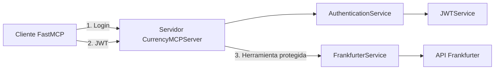

# FastMCP con autenticación JWT y Frankfurter

Este proyecto es un ejemplo completo de un servidor MCP que:

- autentica usuarios mediante usuario y contraseña;
- genera y valida JWT;
- protege herramientas MCP con JWT;
- consulta tasas de cambio mediante la API de Frankfurter;
- utiliza un cliente MCP para ejecutar el flujo completo.

## Diagrama de arquitectura



## Requisitos

- Python 3.12 o superior.
- UV.
- Acceso a Internet para consultar Frankfurter.

## Estructura del proyecto

```text
app/
├── auth/
│   ├── auth_controller.py
│   ├── auth_models.py
│   ├── exceptions.py
│   └── jwt_service.py
├── client/
│   └── mcp_client.py
├── config/
│   └── settings.py
├── mcp_server/
│   ├── server.py
│   └── tools.py
├── services/
│   └── frankfurter_service.py
└── logging_config.py

tests/
├── test_authentication.py
└── test_frankfurter_service.py

.env.example
pyproject.toml
README.md
```

## 1. Abrir la terminal en la carpeta del proyecto

```powershell
cd "C:\LOCAL_JD\LAB_PRUEB_SCRIPTS\Python\Curso_orquestacion_IA_MCP_FastAPI\mcp-labs\fastmcp-auth-demo"
```

Comprueba que UV esté disponible:

```powershell
uv --version
```

## 2. Instalar las dependencias

Ejecuta:

```powershell
uv sync --extra dev --system-certs
```

La opción `--system-certs` hace que el proyecto use el almacén de certificados del sistema Windows. Esto evita el error SSL cuando el entorno tiene una cadena de confianza diferente a `certifi`.

## 3. Crear el archivo de configuración

Copia el ejemplo:

```powershell
Copy-Item .env.example .env
```

El archivo `.env` contiene variables como:

```env
JWT_SECRET_KEY=replace-with-a-long-random-secret
JWT_ALGORITHM=HS256
JWT_EXPIRATION_MINUTES=30
FRANKFURTER_BASE_URL=https://api.frankfurter.dev/v1
FRANKFURTER_TIMEOUT_SECONDS=10.0
APP_NAME=CurrencyMCPServer
```

> En un proyecto real, `JWT_SECRET_KEY` debe ser una clave secreta larga y aleatoria.

## 4. Probar el servidor MCP

```powershell
uv run fastmcp-auth-server
```

El servidor expone dos herramientas:

- `login`: recibe usuario y contraseña y devuelve un JWT.
- `get_exchange_rate`: recibe el JWT, la moneda de origen y la moneda de destino.

El servidor no debe quedar atrapado en un error ni mostrar una excepción al iniciarse.


# Ver el JWT
uv run python -c "from app.auth.auth_controller import create_authentication_service; from app.auth.auth_models import LoginRequest; service=create_authentication_service(); token=service.login(LoginRequest(username='admin', password='Admin123*')); print(token.access_token)"

## 5. Probar el cliente MCP
En otra terminal, dentro de la misma carpeta, ejecuta:

```powershell
uv run fastmcp-auth-client
```

El resultado esperado es similar a:

```text
JWT obtained from MCP server
Tasa actual: 1 USD = 0.8940 EUR
Fecha: 2026-10-08
```

## 6. Flujo paso a paso

1. El cliente llama a `login` con `admin` y `Admin123*`.
2. `AuthenticationService` valida las credenciales.
3. `JWTService` genera un token con los claims `sub`, `iat` y `exp`.
4. El cliente envía el token a `get_exchange_rate`.
5. La herramienta verifica el JWT.
6. `FrankfurterService` realiza la consulta a la API externa.
7. La respuesta se devuelve al cliente MCP.

## 7. Probar la API directamente

```powershell
uv run python -c "from app.services.frankfurter_service import FrankfurterService; print(FrankfurterService().get_exchange_rate('USD', 'EUR'))"
```

También puedes comprobar la URL directamente:

```powershell
curl.exe "https://api.frankfurter.dev/v1/latest?from=USD&to=EUR"
```

## 8. Ejecutar las pruebas

```powershell
uv run pytest -q
```

La suite verifica:

- inicio de sesión válido;
- credenciales inválidas;
- JWT válido;
- JWT inválido;
- respuesta correcta de Frankfurter;
- moneda de destino inexistente.

## 9. Diagnosticar problemas

### Error de certificado SSL

Si aparece un mensaje parecido a:

```text
CERTIFICATE_VERIFY_FAILED
self-signed certificate in certificate chain
```

utiliza el comando de instalación con `--system-certs`:

```powershell
uv sync --extra dev --system-certs
```

Después vuelve a ejecutar:

```powershell
uv run fastmcp-auth-client
```

### Error al iniciar el servidor

Comprueba que estés usando el entorno virtual del proyecto y que no exista otro proceso bloqueando el ejecutable:

```powershell
uv run fastmcp-auth-server
```

Si UV indica que el ejecutable está bloqueado, cierra cualquier proceso anterior del servidor y vuelve a intentarlo.

### Error de credenciales

Los credenciales de ejemplo son:

```text
Usuario: admin
Contraseña: Admin123*
```

## 10. Datos del JWT

- Algoritmo: `HS256`.
- Expiración: 30 minutos.
- Claims principales: `sub`, `iat` y `exp`.

Ejemplo de carga:

```json
{
  "sub": "admin",
  "iat": 1735689600,
  "exp": 1735691400
}
```

## 11. API externa

Endpoint de ejemplo:

```http
GET https://api.frankfurter.dev/v1/latest?from=USD&to=EUR
```

## 12. Consideraciones de seguridad

- El almacén de usuarios es únicamente en memoria.
- Las contraseñas no están hasheadas porque este ejemplo se centra en JWT.
- La validación del JWT es stateless.
- Este es un ejemplo educativo y no es una implementación de seguridad lista para producción.

## 13. Resultado esperado al finalizar

Cuando el flujo funciona correctamente, el cliente debe:

1. iniciar sesión;
2. obtener un JWT;
3. invocar la herramienta protegida;
4. recibir la tasa de cambio;
5. ejecutar todas las pruebas sin errores.
